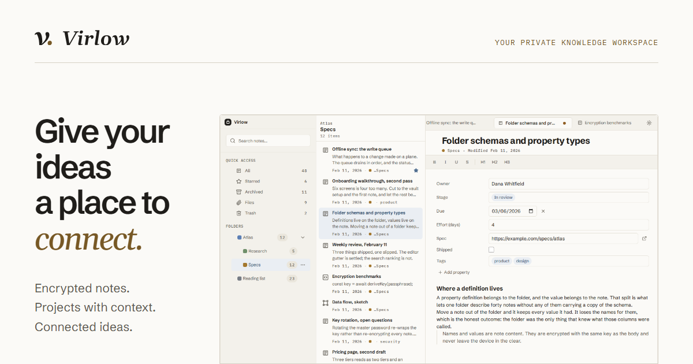

<p align="center">
  
</p>

<h1 align="center">Virlow for desktop</h1>

<p align="center">
  Your private knowledge workspace, in its own window.<br>
  Encrypted notes, projects with context and connected ideas, on Windows, macOS and Linux.
</p>

<p align="center">
  <a href="https://github.com/virlow-hq/virlow-desktop/releases/latest"></a>
  
  
</p>

<p align="center">
  <a href="https://virlow.com"><b>virlow.com</b></a>
  &nbsp;·&nbsp;
  <a href="https://github.com/virlow-hq/virlow-desktop/releases/latest"><b>All downloads</b></a>
  &nbsp;·&nbsp;
  <a href="https://virlow.com/privacy.html"><b>Privacy</b></a>
</p>

<br>

<p align="center">
  
</p>

## Download

| System | Installer |
|---|---|
| **Windows** 10 and 11 | [**Virlow-Setup.exe**](https://github.com/virlow-hq/virlow-desktop/releases/latest/download/Virlow-Setup.exe) |
| **macOS**, Apple silicon | [**Virlow-arm64.dmg**](https://github.com/virlow-hq/virlow-desktop/releases/latest/download/Virlow-arm64.dmg) |
| **macOS**, Intel | [**Virlow-x64.dmg**](https://github.com/virlow-hq/virlow-desktop/releases/latest/download/Virlow-x64.dmg) |
| **Linux** | [**Virlow-x86_64.AppImage**](https://github.com/virlow-hq/virlow-desktop/releases/latest/download/Virlow-x86_64.AppImage) or [**Virlow-amd64.deb**](https://github.com/virlow-hq/virlow-desktop/releases/latest/download/Virlow-amd64.deb) |

The links always point at the newest release. Older versions are on the [releases page](https://github.com/virlow-hq/virlow-desktop/releases).

## What you get

**Your whole workspace.** The desktop app is the Virlow web app in a native window: your notes, folders, projects and memories, with the same account.

**Your AI tools, on your terms.** It runs the local AI connector, so Claude Code, Cursor, Claude Desktop and Codex on the same computer can use your notes and memories. The encryption key stays on the computer.

**Always current.** Installed copies update themselves. Install once and you are done.

## Install

<details>
<summary><b>Windows</b></summary>
<br>

Run `Virlow-Setup.exe` and follow the installer. Virlow appears in the Start menu.

</details>

<details>
<summary><b>macOS</b></summary>
<br>

Open the `.dmg` for your Mac (Apple silicon for M-series chips, Intel for older Macs) and drag Virlow into Applications.

</details>

<details>
<summary><b>Linux</b></summary>
<br>

AppImage:

```sh
chmod +x Virlow-x86_64.AppImage
./Virlow-x86_64.AppImage
```

Debian and Ubuntu:

```sh
sudo apt install ./Virlow-amd64.deb
```

</details>

## About this repository

This repository holds the desktop releases only. The source is not published here.

Questions or problems? Write to [team@batalabs.com](mailto:team@batalabs.com).

<br>

<p align="center">
  <sub>Made by <a href="https://virlow.com">Bata Labs</a></sub>
</p>
